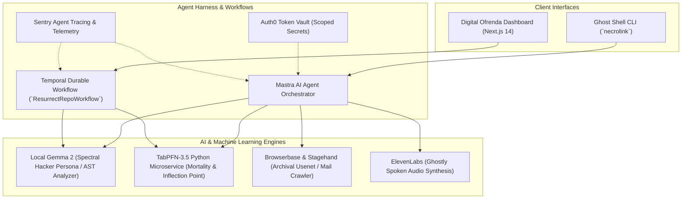

# 🕯️ NecroLink: The Living Terminal & Digital Ofrenda
### *Bridging Forgotten Open-Source Repositories, Legacy Codebases, and Living Memory*

[](file:///C:/Users/david/src/--misc/hacktoberfest/tsconfig.json)
[](file:///C:/Users/david/src/--misc/hacktoberfest/.venv)
[](file:///C:/Users/david/src/--misc/hacktoberfest/analysis/app.py)
[](file:///C:/Users/david/src/--misc/hacktoberfest/workflows/src/workflows.ts)
[](file:///C:/Users/david/src/--misc/hacktoberfest/agent/src/mastra.ts)

---

## 🌟 Overview

In Mexican Día de los Muertos tradition, the dead never truly perish until the living cease to speak their names. In open source, millions of foundational repositories lie dormant—abandoned when original maintainers burned out, passed away, or moved on, yet quietly supporting modern software infrastructure.

**NecroLink** bridges forgotten open-source codebases and living memory through two complementary interfaces:
1. **Ghost Shell (CLI)**: An interactive terminal assistant where the spirit of an archived or legacy codebase (historical C, FORTRAN, early Unix utilities) "possesses" the developer's shell, whispering vintage architectural lore, syntax translations, and debugging wisdom between commands.
2. **Digital Ofrenda (Web UI)**: An interactive memorial dashboard rendering a glowing, candlelit altar honoring open-source ancestors, displaying historical contributor impact, TabPFN mortality post-mortems, and synthesized spoken reflections.

---

## 🏛️ System Architecture



---

## 🚀 Key Features & Partner Integrations

| Technology / Partner | Integration Role in NecroLink | Implementation Path |
| :--- | :--- | :--- |
| **Local Gemma 2** | Spectral vintage hacker persona, AST analysis, legacy K&R C / FORTRAN translation to safe Rust, poetic Día de los Muertos memorial epitaphs with resilient offline fallback. | [`agent/src/gemmaProvider.ts`](file:///C:/Users/david/src/--misc/hacktoberfest/agent/src/gemmaProvider.ts) |
| **TabPFN-3.5** | Tabular foundation model predicting abandonment risk scores (`[commit_interval_days, author_count, deletions_ratio, issue_resolution_latency]`) and locating exact tipping inflection points. | [`analysis/app.py`](file:///C:/Users/david/src/--misc/hacktoberfest/analysis/app.py) |
| **Mastra Agent Harness** | Autonomous orchestration engine uniting tools, session memory store, and LLM reasoning. | [`agent/src/mastra.ts`](file:///C:/Users/david/src/--misc/hacktoberfest/agent/src/mastra.ts) |
| **Temporal SDK** | Durable execution workflow (`ResurrectRepoWorkflow`) guaranteeing complete multi-stage resurrection across network failures and timeouts. | [`workflows/src/workflows.ts`](file:///C:/Users/david/src/--misc/hacktoberfest/workflows/src/workflows.ts) |
| **ElevenLabs** | Ghostly voice synthesis streaming eerie terminal whispers and spoken altar eulogies with cross-platform native playback. | [`cli/lib/terminalAudio.ts`](file:///C:/Users/david/src/--misc/hacktoberfest/cli/lib/terminalAudio.ts) |
| **Browserbase & Stagehand** | Archival web scraper retrieving vintage Usenet discussions (`comp.unix.wizards`) and obsolete bug tracker threads. | [`agent/src/tools/browserbaseTool.ts`](file:///C:/Users/david/src/--misc/hacktoberfest/agent/src/tools/browserbaseTool.ts) |
| **Auth0 for AI Agents** | Token Vault client handling developer identity and token-scoped access to external GitHub repos without saving plaintext tokens to disk. | [`agent/src/auth.ts`](file:///C:/Users/david/src/--misc/hacktoberfest/agent/src/auth.ts) |
| **Sentry** | Distributed agent tracing, LLM token metrics, latency waterfalls, and tool execution breadcrumbs. | [`agent/src/telemetry.ts`](file:///C:/Users/david/src/--misc/hacktoberfest/agent/src/telemetry.ts) |
| **Render & .tech** | Multi-service production deployment (`render.yaml`, `Dockerfile`) configured for `necrolink.tech` and `ofrenda.necrolink.tech`. | [`render.yaml`](file:///C:/Users/david/src/--misc/hacktoberfest/render.yaml) |

---

## 🛠️ Quickstart Guide

### 1. Prerequisites
- **Node.js**: v20+ or v24+
- **Python**: 3.12 or 3.13 (`py -3.12` or `python3.12`)
- **Git**

### 2. Environment Setup
```bash
# Clone the repository
git clone https://github.com/necrolink/necrolink.git
cd necrolink

# Provision Python 3.12 Virtual Environment & Install Dependencies
py -3.12 -m venv .venv
.\.venv\Scripts\python.exe -m pip install -r analysis/requirements.txt

# Install Node Monorepo Dependencies
npm install
```

### 3. Running the Verification Suite
Execute the end-to-end verification script to run Python PyTests, Monorepo TypeCheck, and CLI smoke tests:

**PowerShell (Windows):**
```powershell
.\tests\run_all_checks.ps1
```

**Bash (Linux / macOS):**
```bash
bash tests/run_all_checks.sh
```

---

## 💻 Ghost Shell (CLI) Usage

### Enter Possession Mode
Step inside an interactive terminal session where the spirit of a legacy codebase inhabits your prompt:
```bash
npx tsx cli/bin/necrolink.ts possession unix-v6-legacy
```
Inside the possessed shell:
- Normal shell commands (`dir`, `ls`, `git status`) execute under the observation of the ancestral spirit.
- If a command fails, the spirit diagnoses the error using vintage Unix wisdom.
- Type `altar` to render the candlelit ofrenda.
- Type `translate` to transmute legacy C/FORTRAN into safe modern Rust.
- Type `lore` to hear historical anecdotes from the Bell Labs / Multics era.
- Type `exorcise` to release the possession.

### Durably Resurrect a Repository
```bash
npx tsx cli/bin/necrolink.ts resurrect ./my-target-repo
```

### Run TabPFN Anomaly & Mortality Prediction
```bash
npx tsx cli/bin/necrolink.ts analyze unix-v6-legacy
```

### Generate Día de los Muertos Eulogy
```bash
npx tsx cli/bin/necrolink.ts eulogy fortran-matrix-v1
```

### Simulate GitHub `repository.archived` Webhook Ingestion
```bash
npx tsx cli/bin/necrolink.ts simulate-archive fortran-matrix-v1
```

---

## ⚡ Live GitHub Webhook Ingestion

NecroLink operates a live webhook receiver endpoint at `/api/webhooks/github` that automatically listens for repository deprecation and archival events:
1. **Supported Webhook Events**:
   - `repository` (action: `archived`): Triggered when a maintainer officially archives a repository.
   - `issues` (action: `labeled` with `memorial` or `resurrect`): Triggered when community members request memorial tribute for a dormant library.
   - `ping`: GitHub webhook handshake validation.
2. **Security**: Verifies payload integrity via `X-Hub-Signature-256` HMAC SHA-256 using timing-safe comparison with `GITHUB_WEBHOOK_SECRET`.
3. **Automated Dispatch**:
   - If `GITHUB_TOKEN` is configured, automatically posts an evocative Memorial Post-Mortem issue comment celebrating the maintainers.
   - Saves formatted memorial Markdown artifacts into the local [`memorials/`](file:///C:/Users/david/src/--misc/hacktoberfest/memorials/) directory.

---

## 🌐 Digital Ofrenda Web Dashboard

Launch the candlelit Next.js interactive memorial altar:
```bash
npm run dev --workspace=web
```
Open [http://localhost:3000](http://localhost:3000) in your browser:
- **Interactive Altar**: Flickering candles, cempasúchil marigolds, and maintainer gravestones.
- **Tribute Petals**: Click to offer orange marigold petals to resting codebases.
- **Live TabPFN Mortality Gauges**: Visual metrics for commit interval, author cadence, deletions ratio, and issue latency.
- **Terminal Whisper Audio Visualizer**: Spoken spectral audio reflections with real-time waveform animation.
- **Live Resurrection Ritual**: Enter any repository URL or identifier to perform live analysis and altar placement.

---

## 🚢 Deployment (Render & .tech Domain)

The repository includes a ready-to-deploy [`render.yaml`](file:///C:/Users/david/src/--misc/hacktoberfest/render.yaml) blueprint declaring:
1. `necrolink-web`: Next.js production SSR application (`ofrenda.necrolink.tech`).
2. `necrolink-tabpfn-api`: Python 3.12 FastAPI microservice running TabPFN-3.5 (`api.necrolink.tech`).

To configure your `.tech` custom domain:
1. In your `.tech` DNS management panel (e.g., Namecheap / Google Domains), add a CNAME record:
   - `ofrenda` -> `necrolink-web.onrender.com`
   - `api` -> `necrolink-tabpfn-api.onrender.com`
2. In Render, link custom domains `ofrenda.necrolink.tech` and `api.necrolink.tech`. Render automatically provisions managed SSL/TLS certificates.

---

## 📜 License
MIT License. Crafted with reverence for the open-source ancestors who came before us.
