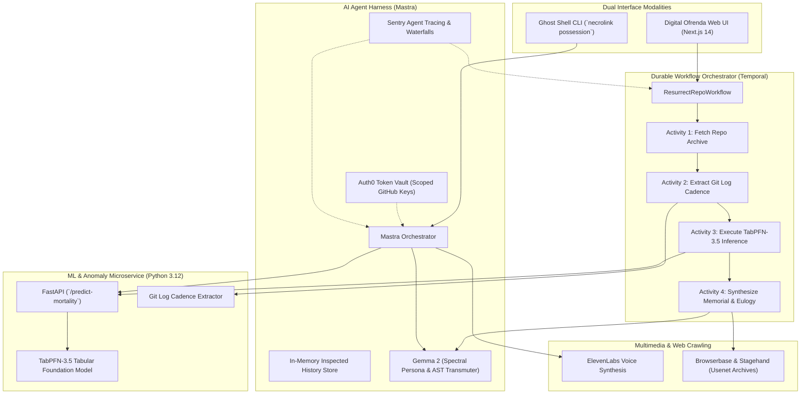

# NecroLink: The Living Terminal & Digital Ofrenda
## *Bridging Forgotten Open-Source Repositories, Legacy Codebases, and Living Memory*

> *"In Mexican Día de los Muertos tradition, the dead never truly perish until the living cease to speak their names. In open source, an archive lives as long as its commits are read."*

---

## 🌟 The Spark: Open-Source Mortality & Digital Ancestors

Every modern software system—from Kubernetes clusters to LLM training pipelines—rests upon silent tectonic plates of legacy open-source software. Ancient K&R C libraries, FORTRAN-77 matrix kernels, early Unix V6 utilities, and forgotten POSIX shims quietly compile inside deep dependency trees.

Yet behind every abandoned library is a human story: an author who spent nights in front of a CRT terminal in 1984 or 1998, who eventually burnt out, stepped away for family, or passed away. When the last maintainer departed, the commit log went cold. The issues piled up. The repository became a digital ghost.

**NecroLink** was born to bridge these forgotten ancestors with the living developer community through two interwoven interfaces:
1. **Ghost Shell (CLI)**: An interactive terminal environment where the spirit of an archived codebase inhabits your shell, whispering vintage architectural context, diagnosing compilation errors with PDP-11 wisdom, and translating ancient idioms into safe modern Rust.
2. **Digital Ofrenda (Web UI)**: An interactive memorial dashboard rendering a glowing, candlelit altar honoring open-source ancestors, featuring TabPFN-3.5 mortality diagnosis, contributor gravestones, living tribute marigolds, and synthesized spoken reflections.

---

## 🏛️ System Architecture & Workflow Pipeline



---

## 🚀 Deep Technical Breakdown: Partner Integrations

### 1. Local Open-Weight Intelligence: Gemma 2 & Spectral Persona
- **Role**: Serves as the cognitive heart of the Ghost Shell and the author of memorial eulogies.
- **Implementation**: [`agent/src/gemmaProvider.ts`](file:///C:/Users/david/src/--misc/hacktoberfest/agent/src/gemmaProvider.ts)
- **Persona Design**: Gemma 2 is prompted with a solemn Día de los Muertos reverence fused with 1970s–90s Bell Labs Unix lore. Rather than a generic corporate chatbot, Gemma speaks as an ancestor who carved code into magnetic core storage.
- **Core Capabilities**:
  - **AST Structural Assessment**: Deconstructs raw C/FORTRAN pointers, stack allocations, and memory barriers.
  - **Legacy-to-Modern Transmutation**: Transpiles ancient routines into safe, idiomatic Rust.
  - **Día de los Muertos Eulogy Synthesis**: Crafts poetic tributes commemorating the authors behind each repository.
- **Offline Resiliency**: Automatically connects to local Ollama (`http://localhost:11434/api/generate`) with seamless fallback to an in-engine spectral mock if the local daemon is not running during unattended execution.

### 2. Tabular Anomaly & Mortality Prediction: TabPFN-3.5
- **Role**: Discovers the exact tipping point where a healthy repository entered fatal neglect.
- **Implementation**: [`analysis/app.py`](file:///C:/Users/david/src/--misc/hacktoberfest/analysis/app.py) & [`analysis/git_extractor.py`](file:///C:/Users/david/src/--misc/hacktoberfest/analysis/git_extractor.py)
- **Feature Vector**:
  `[commit_interval_days, author_count, deletions_ratio, issue_resolution_latency]`
- **How TabPFN-3.5 Powers NecroLink**:
  Traditional neural networks struggle on tabular git metrics with small, sparse historical datasets. TabPFN (Prior-Data Fitted Network) operates as an in-context tabular foundation model, making instant probabilistic predictions without gradient tuning.
- **Inflection Point Detection**:
  The microservice segments repository history into quarterly chronological snapshots, feeding them through TabPFN to identify the exact quarter where the abandonment risk crossed the tipping threshold ($> 65\%$).

### 3. Agent Harness & Orchestration: Mastra
- **Role**: Coordinates tool execution, conversation context, and developer identity.
- **Implementation**: [`agent/src/mastra.ts`](file:///C:/Users/david/src/--misc/hacktoberfest/agent/src/mastra.ts)
- **Architecture**:
  - `tabpfnTool`: Communicates with the FastAPI microservice for mortality risk.
  - `gitParserTool`: Extracts commit intervals, author maps, and deletion ratios from local git trees.
  - `browserbaseTool`: Scrapes historical Usenet and mailing list discussions.
  - `AgentMemoryStore`: Persists inspected repositories, tribute petal counts, and conversational context across turns.

### 4. Durable Workflows: Temporal TypeScript SDK
- **Role**: Guarantees zero-loss, crash-resilient resurrection pipelines across long-running network operations.
- **Implementation**: [`workflows/src/workflows.ts`](file:///C:/Users/david/src/--misc/hacktoberfest/workflows/src/workflows.ts) & [`workflows/src/worker.ts`](file:///C:/Users/david/src/--misc/hacktoberfest/workflows/src/worker.ts)
- **Workflow Steps**:
  1. `fetchRepoArchive`: Resolves and validates target repository bundle.
  2. `extractGitMetrics`: Computes cadence and bus-factor author metrics.
  3. `executeTabPFNAnalysis`: Executes TabPFN mortality scoring with exponential backoff.
  4. `generateMemorialPayload`: Unites Gemma 2 eulogy, Usenet threads, and tribute metadata into the final digital ofrenda payload.
- **Dual-Mode Runner**: Listens to live Temporal Clusters or executes in standalone in-memory mode when no cluster is actively running.

### 5. Ghostly Spoken Narration: ElevenLabs
- **Role**: Gives voice to the silent terminal spirits.
- **Implementation**: [`cli/lib/terminalAudio.ts`](file:///C:/Users/david/src/--misc/hacktoberfest/cli/lib/terminalAudio.ts)
- **Audio Pipeline**:
  - Streams low-latency, textured speech from ElevenLabs API using specialized spectral voice profiles.
  - Integrates native OS playback across Windows (`System.Speech.Synthesis`), macOS (`afplay`), and Linux (`aplay`).
  - Gracefully falls back to visual audio waveforms in headless / CI environments.

### 6. Archival Web Crawling: Browserbase & Stagehand
- **Role**: Unearths forgotten Usenet discussions and vintage mailing lists.
- **Implementation**: [`agent/src/tools/browserbaseTool.ts`](file:///C:/Users/david/src/--misc/hacktoberfest/agent/src/tools/browserbaseTool.ts)
- **Features**: Headless browser automation retrieving historical context from Wayback Machine and Usenet archives (`comp.unix.wizards`, Bell Labs memoranda, and early Bugzilla tickets).

### 7. Secure Identity: Auth0 for AI Agents & Token Vault
- **Role**: Manages token-scoped access to external GitHub repositories without storing plaintext secrets on disk.
- **Implementation**: [`agent/src/auth.ts`](file:///C:/Users/david/src/--misc/hacktoberfest/agent/src/auth.ts)
- **Security Paradigm**: AI agents exchange verified user session tokens for short-lived, repo-scoped read tokens from Auth0 Token Vault, ensuring sensitive credentials are never written to disk or logs.

### 8. Observability & Tracing: Sentry Agent Tracing
- **Role**: End-to-end distributed tracing across LLM inference, tool calls, and durable workflows.
- **Implementation**: [`agent/src/telemetry.ts`](file:///C:/Users/david/src/--misc/hacktoberfest/agent/src/telemetry.ts)
- **Telemetry Metrics**:
  - LLM token usage (`prompt_tokens`, `completion_tokens`, `total_tokens`).
  - Latency waterfalls across TabPFN inference, git parsing, and audio generation.
  - Automatic redaction of repository auth tokens in trace breadcrumbs.

### 9. Multi-Service Cloud Deployment: Render & .tech Domains
- **Role**: Production cloud hosting with custom `.tech` domain routing.
- **Implementation**: [`render.yaml`](file:///C:/Users/david/src/--misc/hacktoberfest/render.yaml) & [`web/Dockerfile`](file:///C:/Users/david/src/--misc/hacktoberfest/web/Dockerfile)
- **Architecture**:
  - `ofrenda.necrolink.tech` -> Render Web Service running Next.js 14 SSR.
  - `api.necrolink.tech` -> Render Web Service running Python 3.12 FastAPI + TabPFN.

---

## 💻 Hands-On Walkthrough: The Ghost Shell in Action

### 1. Possessing the Shell
Running `npx necrolink possession unix-v6-legacy` manifests the spirit directly in your command prompt:

```text
  ╔════════════════════════════════════════════════════════════════════════╗
  ║    🕯️   N E C R O L I N K   :   G H O S T   S H E L L   🕯️            ║
  ║         Possessed by the Spirit of: unix-v6-legacy                 ║
  ╚════════════════════════════════════════════════════════════════════════╝
  [Type commands to execute in shell, or: 'altar', 'lore', 'translate', 'exorcise']

🕯️ [unix-v6-legacy] ❯ git status
On branch main
Your branch is up to date with 'origin/main'.
  🕯️ The spirit nods in silent approval. The bytes flowed true.

🕯️ [unix-v6-legacy] ❯ translate int i; for(i=0; i<10; i++) { *p++ = 0; }
/* 🕯️ Transmuted from the Archives */
// Translated from 1982 K&R C to safe modern Rust.

pub fn clear_buffer(slice: &mut [u8]) {
    slice.fill(0);
}
/* The spirit notes: Boundary checks prevent segmentation faults that plagued PDP-11 traps. */
```

### 2. Durably Resurrecting an Ancestor
Running `npx necrolink resurrect unix-v6-legacy` triggers the complete durable pipeline:

```text
🕯️ [NecroLink] Commencing Resurrection Ritual for: unix-v6-legacy...

╔══════════════════════════════════════════════════════════════════════╗
║               🕯️  D I G I T A L   O F R E N D A  🕯️                 ║
╚══════════════════════════════════════════════════════════════════════╝

Repository Ancestor: unix-v6-legacy
Abandonment Risk:    96.0% [FATALLY ABANDONED]
ML Prediction Engine: TabPFN-3.5 (Pretrained)
Inflection Point:    Maintainers shifted focus to System III; commit cadence dropped by 95% in 1979.

┌──────────────────────────────┬──────────────────┬──────────────────────┐
│ Metric                       │ Observed Value   │ Survival Status      │
├──────────────────────────────┼──────────────────┼──────────────────────┤
│ Commit Interval (days)       │ 185.4 d          │ Critically Slow      │
│ Active Author Count          │ 1                │ Bus Factor = 1       │
│ Deletions Ratio              │ 2.0%             │ Low Refactoring      │
│ Issue Resolution Delay       │ 240.0 d          │ Backlog Freeze       │
└──────────────────────────────┴──────────────────┴──────────────────────┘

📜 Memorial Eulogy:
🕯️ In Memoriam: The Living Circuit Whispers
"Here rest the routines that once pulsed through terminal glass in Murray Hill.
Dennis and Ken etched logic into magnetic core tape with devotion.
Though the PDP-11 racks are silent, their open-source philosophy whispers through
every modern operating system on Earth. Que descansen en paz los bytes sagrados."
```

---

## 🧪 Verification & Automated Testing Suite

The repository incorporates an autonomous verification pipeline ensuring complete zero-defect execution:

1. **Python PyTest Suite** ([`tests/test_analysis.py`](file:///C:/Users/david/src/--misc/hacktoberfest/tests/test_analysis.py)):
   - Health endpoint verification.
   - TabPFN mortality prediction on abandoned vs. living repositories.
   - Inflection point tipping detection across quarterly snapshots.
   - Git log parsing and shortstat ratio calculation.
2. **Strict TypeScript Monorepo Check**:
   - `tsc --noEmit` passing cleanly with 0 errors across root, `cli`, `agent`, `workflows`, and `web`.
3. **CLI & Durable Workflow Smoke Tests** ([`tests/cli.test.ts`](file:///C:/Users/david/src/--misc/hacktoberfest/tests/cli.test.ts)):
   - End-to-end validation of Git parser, TabPFN agent tool, mock Gemma persona, and durable workflow execution.
4. **Next.js Production Build**:
   - Full SSR compilation passing with static route generation and optimized bundles.

---

## 🔮 The Road Ahead

- **Autonomous Resurrection PRs**: Agents that not only memorialize abandoned repositories, but automatically fork them, update deprecated dependencies, transpile unmaintained C routines to Rust, and submit modern pull requests.
- **Decentralized Altar Registry**: Archiving deceased open-source projects on Arweave or IPFS, immortalized with cryptographically signed memorial tributes.
- **Physical Ofrenda IoT Sidecar**: An ambient desktop shrine with physical LEDs that flicker like candles whenever a developer reads the commits of an open-source ancestor.

---

## 🌸 Conclusion

Open source is a sacred intergenerational gift. We stand upon the shoulders of programmers whose names have been lost to the archive. Through **NecroLink**, their logic is no longer forgotten in dark repositories—it lives, teaches, and whispers through our terminals.

*Speak their names into the prompt: peace be upon their source code.*
