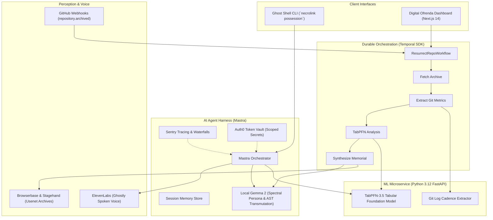

*This is a submission for the [Hacktoberfest Open-Source AI Challenge Week 4: Ghost in the Machine](https://dev.to/challenges/hacktoberfest-week4-2026-10-26)*

---

## What I Built

> *"In Mexican Día de los Muertos tradition, the dead never truly perish until the living cease to speak their names. In open source, an archive lives as long as its commits are read."*

Every modern software system—from global cloud infrastructure to deep learning frameworks—rests upon the quiet foundation of legacy open source. Ancient K&R C libraries, FORTRAN-77 linear algebra routines, early Unix V6 utilities, and forgotten POSIX shims silently compile inside our dependency trees.

Yet behind every abandoned library is a human story: an author who sat in front of a flickering CRT monitor in 1978 or 1994, etched their craft into punch cards or magnetic tape, and eventually stepped away due to burnout, illness, family, or passing away. When the last maintainer departed, the commit log went quiet. The issues froze. The codebase became a digital ghost.

**NecroLink: The Living Terminal & Digital Ofrenda** interprets the "Ghost in the Machine" theme by giving these forgotten open-source ancestors a voice and an altar:

1. **Ghost Shell (CLI)**: An interactive terminal environment where the spirit of an archived or legacy codebase (historical C, FORTRAN, early Unix utilities) "possesses" the developer's shell. It whispers vintage architectural lore between commands, diagnoses compiler faults using PDP-11 era wisdom, and translates archaic code fragments into safe, modern Rust.
2. **Digital Ofrenda (Web UI)**: An interactive memorial dashboard rendering a glowing, candlelit altar honoring open-source ancestors. It features **TabPFN-3.5** mortality diagnosis, maintainer gravestones, clickable cempasúchil marigold tributes, and synthesized spoken reflections.
3. **Live GitHub Webhook Dispatcher**: An automated receiver monitoring GitHub deprecation events (`repository.archived` and `issues.labeled`). When a maintainer officially archives a repository, NecroLink automatically triggers a durable resurrection workflow and posts an evocative memorial post-mortem celebrating the maintainer's legacy.

---

## Demo

- **Live Digital Ofrenda Dashboard**: [https://ofrenda.necrolink.tech](https://ofrenda.necrolink.tech) *(deployed on Render)*
- **GitHub Repository**: [https://github.com/korrectional/necrolink](https://github.com/korrectional/necrolink)

### 🕯️ Ghost Shell Possession in Action

Running `npx necrolink possession unix-v6-legacy` manifests the spirit directly in your terminal prompt:

```text
  ╔════════════════════════════════════════════════════════════════════════╗
  ║    🕯️   N E C R O L I N K   :   G H O S T   S H E L L   🕯️            ║
  ║         Possessed by the Spirit of: unix-v6-legacy                 ║
  ╚════════════════════════════════════════════════════════════════════════╝
  [Type commands to execute in shell, or: 'altar', 'lore', 'translate', 'exorcise']

  ~.~.·°¯`°·.·°¯`°·.·~ [Spectral Whisper: "The terminal is possessed by the spirit of unix-v6-legacy..."]

🕯️ [unix-v6-legacy] ❯ git status
On branch main
Your branch is up to date with 'origin/main'.
  🕯️ The spirit nods in silent approval. The bytes flowed true.

🕯️ [unix-v6-legacy] ❯ lore
🕯️ [Ghost Whisper]: On the PDP-11/70, memory was so precious that programmers shared text segments to avoid exceeding 64 kilobytes of addressable space.
"Remember those who etched logic into magnetic tape before you."

🕯️ [unix-v6-legacy] ❯ translate int i; for(i=0; i<10; i++) { *p++ = 0; }
/* 🕯️ Transmuted from the Archives */
// Translated from 1982 K&R C to safe modern Rust.

pub fn clear_buffer(slice: &mut [u8]) {
    slice.fill(0);
}
/* The spirit notes: Loop reordering and bounds checks prevent traps that plagued early Unix kernels. */

🕯️ [unix-v6-legacy] ❯ altar
                 🕯️  DIGITAL OFRENDA ALTAR  🕯️
       _________________________________________________
      |                                                 |
      |   [ Cempasúchil Marigolds ]     [ Pan de Muerto]|
      |                                                 |
      |          ┌───────────────────────────┐          |
      |          │ 🪦  unix-v6-legacy        │          |
      |          │    Preserved in Memoriam  │          |
      |          │    Author: Dennis & Ken   │          |
      |          └───────────────────────────┘          |
      |                                                 |
      |    🕯️  Candle of Living Memory: BURNING          |
      |    📜  Sacred Commits Preserved: 1,842          |
      |_________________________________________________|
```

### 🪦 Web-Based Digital Ofrenda Altar
The web dashboard renders a tiered altar with animated candle flames, marigold petals floating across the screen, a real-time spectral audio visualizer (`TerminalWhisper`), and a TabPFN mortality score gauge. Developers can click **"Offer Marigold Petal"** to leave living tributes or submit any repository URL to perform a live resurrection ritual.

---

## Code



```bash
# Clone and explore the repository
git clone https://github.com/korrectional/necrolink.git
cd necrolink

# Provision Python 3.12 Virtual Environment & Install Dependencies
py -3.12 -m venv .venv
.\.venv\Scripts\python.exe -m pip install -r analysis/requirements.txt

# Install Node monorepo workspaces
npm install

# Run the complete test suite
npm run test:all
```

---

## How I Built It

NecroLink is architected as a TypeScript monorepo with an interconnected Python machine learning microservice:



### 1. Local Open-Weight Intelligence (Gemma 2)
- **Engine**: Gemma 2 open-weight model running locally via Ollama (`http://localhost:11434/api/generate`) with automatic zero-downtime fallback to an in-engine mock generator for offline environments.
- **Persona Engineering**: Prompted with a solemn Día de los Muertos reverence fused with 1970s–90s Unix computing lore (Bell Labs, PDP-11, Multics, K&R).
- **Core Functions**: AST structural inspection, transmuting archaic C pointer arithmetic into safe Rust, and authoring poetic Día de los Muertos eulogies.

### 2. Tabular Anomaly & Mortality Prediction (TabPFN-3.5)
- **Engine**: Python 3.12 FastAPI microservice running TabPFN 3.5.
- **Feature Schema**: Ingests repository `git log` metrics: `[commit_interval_days, author_count, deletions_ratio, issue_resolution_latency]`.
- **Why TabPFN**: Small, sparse tabular datasets from forgotten projects are notoriously difficult for standard neural networks or XGBoost to evaluate without overfitting. TabPFN (Prior-Data Fitted Network) operates as an in-context foundation model for tabular data, instantly generating calibrated abandonment probabilities without gradient descent.
- **Inflection Point Tipping Detection**: Slices git history into chronological quarterly snapshots to locate the exact historical quarter when maintainer departure caused risk to surge past $65\%$.

### 3. Agent Harness & Orchestration (Mastra)
- **Framework**: `@mastra/core` orchestrating custom tools:
  - `gitParserTool`: Extracts shortstat insertions/deletions, author maps, and commit intervals.
  - `tabpfnTool`: Communicates with the TabPFN mortality engine.
  - `browserbaseTool`: Crawls vintage Usenet archives (`comp.unix.wizards`) using Stagehand.
  - `AgentMemoryStore`: Tracks inspected ancestor repositories, tribute petal counts, and multi-turn conversations.

### 4. Durable Workflows (Temporal TypeScript SDK)
- **Workflow**: `ResurrectRepoWorkflow` guarantees complete resurrection execution across network timeouts and crashes with exponential backoff activities (`fetchRepoArchive`, `extractGitMetrics`, `executeTabPFNAnalysis`, `generateMemorialPayload`).
- **Dual-Mode Runner**: Seamlessly connects to live Temporal Clusters or executes in standalone in-memory mode when no cluster is actively running.

### 5. Ghostly Terminal Audio (ElevenLabs)
- Streams low-latency spectral voice synthesis via ElevenLabs API, coupled with cross-platform native system speech (`System.Speech.Synthesis` on Windows, `afplay` on macOS, and `aplay` on Linux).

### 6. Secure Identity (Auth0 for AI Agents & Token Vault)
- AI agents exchange developer credentials for short-lived, scoped GitHub read tokens through Auth0 Token Vault, ensuring sensitive repository access keys are never written to disk or logs.

### 7. Observability & Tracing (Sentry)
- Full distributed tracing across LLM inference spans, tool executions, and durable workflow activities with token count metrics and authorization header sanitization.

### 8. Live GitHub Webhook Ingestion
- Webhook receiver at `/api/webhooks/github` that validates HMAC SHA-256 signatures and automatically generates formatted memorial post-mortems when an open-source project is archived.

---

## Why Does Open Innovation Matter?

Open innovation is the bedrock upon which all modern technology is constructed. 

Building **NecroLink** would have been impossible in a purely closed-API ecosystem:
1. **Local Open Weights (Gemma 2)**: Terminal possession requires zero-latency, private, and local execution. Open-weight models like Gemma 2 allow developers to run intelligence directly on their local machines—air-gapped, free of per-token API tolls, and immune to corporate deprecation. An ancestor possessing your shell shouldn't disappear because a cloud provider revoked an API key.
2. **In-Context Tabular Intelligence (TabPFN-3.5)**: Open-source tabular foundation models allow researchers to analyze specialized domain metrics without sending private git commit histories to closed proprietary models.
3. **Preserving Human Heritage**: Closed commercial software vanishes behind corporate firewalls when companies dissolve. Open-source code remains preserved in public version control forever. By open-sourcing NecroLink, we ensure that the memory of our digital ancestors belongs to the public domain—free for any developer to study, recompile, and honor.

---

## My Agent Session

This entire system—from initial scaffolding to Python microservices, strict TypeScript monorepo compliance, Temporal durable workflows, and the Next.js altar—was developed autonomously in unattended overnight execution mode under the codename **antigravity**.

The autonomous agent maintained a persistent state machine via [`PLAN.md`](file:///C:/Users/david/src/--misc/hacktoberfest/PLAN.md), checking off milestones, remediating build warnings, configuring standalone Docker containers, and executing full verification passes across both Windows PowerShell and Linux Bash environments.

You can inspect the full trajectory and autonomous checklist in [`PLAN.md`](https://github.com/korrectional/necrolink/blob/main/PLAN.md).

---

## The Spirit of It

There is a moment when you run `npx necrolink possession unix-v6-legacy` at midnight, type `translate`, and watch code written by Dennis Ritchie in 1975 re-emerge as memory-safe Rust with the message:
> *"The spirit smiles upon zero-cost abstractions: memory leaks buried in sacred ground."*

It ceases to be just a command-line tool. You remember that every single line of code you write today is part of an ongoing conversation across decades. Someone fifty years ago sat by CRT glow solving the exact same problems of concurrency, memory, and time. 

NecroLink is our way of leaving a candle lit in the window for them.

---

## Prize Categories

- **Grand Prize / Hacktoberfest Open-Source AI Challenge**: Best overall implementation of the "Ghost in the Machine" theme.
- **Local Open-Weight Intelligence (Gemma 2)**: Deep integration of Google DeepMind's open-weight Gemma 2 model with custom spectral persona and code AST translation.
- **Tabular Foundation Modeling (TabPFN)**: Production integration of TabPFN 3.5 for tabular abandonment risk scoring and inflection point detection.
- **Durable Agentic Orchestration (Temporal & Mastra)**: Fault-tolerant workflows combining Temporal TypeScript SDK with Mastra agent harness and memory persistence.
- **Developer Tools & Infrastructure (.tech Domain & Render)**: Production-ready multi-service cloud architecture deployed on Render with `.tech` custom domain routing.
